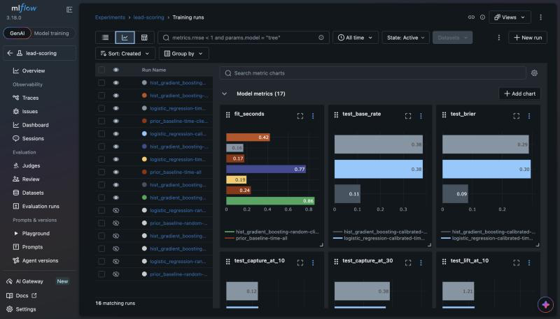
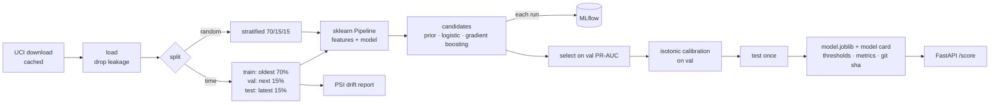
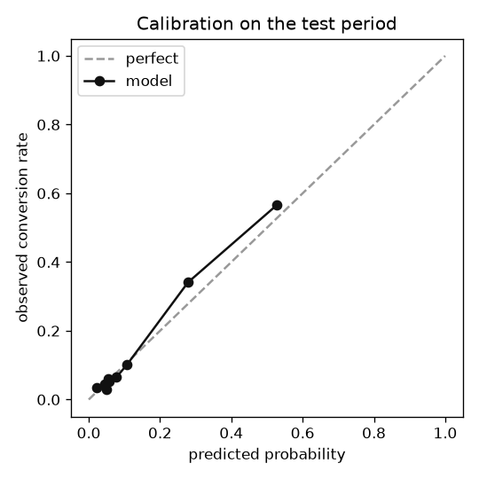
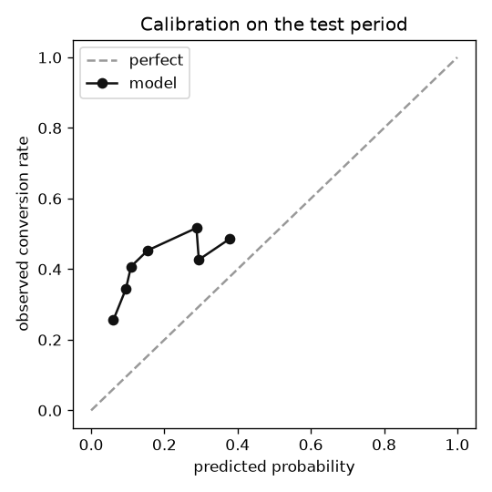

# lead-scoring-ml

[](https://github.com/joaofrancowork/lead-scoring-ml/actions/workflows/ci.yml)


**Which leads should a small sales team call first?** A classical ML pipeline with
scikit-learn, from raw data to a calibrated scoring API. Experiments are tracked in MLflow,
drift is monitored, and every run uses a real public dataset of 41,188 sales contacts.

The most useful result is a warning: **a random train/test split says ROC-AUC 0.81; validated
on the future, the same pipeline scores 0.56–0.59.** The project shows how to find that out
before production does, and how to detect it once deployed.



## Quick start

```bash
git clone https://github.com/joaofrancowork/lead-scoring-ml && cd lead-scoring-ml
uv sync && uv run lead-scoring train     # downloads the data, trains, calibrates, saves artifacts/model
uv run lead-scoring serve                # http://localhost:8000/docs
```

Or `docker build -t lead-scoring . && docker run -p 8000:8000 lead-scoring`: the image
trains in a build stage and ships only the model and the API. `uv run mlflow ui
--backend-store-uri sqlite:///mlflow.db` opens the experiment tracking UI.

## Data

[UCI Bank Marketing](https://doi.org/10.24432/C5K306) (Moro, Rita & Cortez, 2014; CC BY 4.0):
phone contacts from a direct-marketing campaign, labelled with whether the client converted
(11.3% did). It is downloaded at run time and never committed.

- **Leakage removed:** `duration` (the length of the call) predicts the outcome very well, but
  it is only known *after* the call, so it cannot be used to decide whom to call.
- **Time preserved:** rows are in chronological order (May 2008 to Nov 2010), which makes a
  realistic out-of-time test possible.

## Pipeline



- **Features** live in one scikit-learn `Pipeline` shared by training and serving: domain
  features (`pdays = 999` means *never contacted*, not 999 days), log-transformed contact
  counts, one-hot categories with rare-level grouping, and unknown categories ignored at
  inference.
- **Two feature sets**: `all`, and `client`, which leaves out the macroeconomic indicators and
  the calendar month. Those describe *when* a call happened, not *who* the lead is.
- **Metrics a sales team can use**: PR-AUC (11% positives), Brier score (are the probabilities
  honest?), and lift / capture in the top decile ("calling the top 10% reaches X% of the
  conversions").

## Results

Test set, selected and calibrated model ([full report](docs/results.md)):

| Split | Features | ROC-AUC | PR-AUC | Lift@10% | Capture@10% | Brier |
|---|---|---|---|---|---|---|
| random | all | **0.812** | 0.471 | **4.81x** | 48% | 0.074 |
| random | client | 0.734 | 0.355 | 3.39x | 34% | 0.085 |
| time | all | 0.561 | 0.436 | 1.23x | 12% | 0.295 |
| time | client | 0.589 | 0.443 | 1.21x | 12% | 0.289 |

**What happened.** The conversion rate is not stable: it grows from 2.8% in the first tenth of
the data to 45.9% in the last. A random split mixes those periods, so the model learns the
period from the macro features and the score looks excellent. Trained on the past and tested on
the future, ranking quality drops close to chance, and the calibration learned on an 11% base
rate is badly wrong for a 38% one (Brier 0.29).

 

**What the drift report says.** `lead-scoring drift` compares the training period with the
latest contacts using the Population Stability Index. Every macro feature scores between 3 and
11 (alert threshold: 0.25), and so do client-mix features such as `poutcome`, `contact` and
`job`. In production, this is the signal to retrain on a recent window and recalibrate, rather
than to trust last quarter's offline AUC.

**A single split is not enough either.** `lead-scoring backtest` trains on everything before
each cut-off and scores the next period, five times in a row:

| Model | ROC-AUC | PR-AUC | Lift@10% | Base rate (mean) |
|---|---|---|---|---|
| logistic_regression | 0.571 ± 0.103 | 0.253 ± 0.226 | 1.59 ± 0.50 | 17.9% |
| hist_gradient_boosting | 0.561 ± 0.115 | 0.249 ± 0.224 | 1.59 ± 0.78 | 17.9% |
| prior_baseline | 0.500 ± 0.000 | 0.179 ± 0.161 | 1.00 ± 0.00 | 17.9% |

With all features the mean drops to 0.53 ROC-AUC with a wider spread, so the `client` set is
the better choice on average. The ± column is the point: period-to-period variation is as large
as the difference between models.

**What I would ship.** The `client` feature set, retrained on a rolling recent window,
recalibrated to the latest conversion rate, with the drift check as a scheduled job.

## API

```bash
curl -s localhost:8000/score -H 'content-type: application/json' -d '{"leads": [{
  "age": 67, "job": "retired", "marital": "married", "education": "basic.9y", "default": "no",
  "housing": "no", "loan": "no", "contact": "cellular", "month": "nov", "day_of_week": "tue",
  "campaign": 1, "pdays": 3, "previous": 1, "poutcome": "success", "emp_var_rate": -1.8,
  "cons_price_idx": 92.9, "cons_conf_idx": -46.2, "euribor3m": 1.3, "nr_employed": 5099.1}]}'
# {"model":"hist_gradient_boosting","scores":[{"probability":0.5,"priority":"call_first"}]}   (default model: time split, client features)
```

`priority` maps the calibrated probability to the top 10% (`call_first`), the next 20%
(`call_this_week`) and the rest (`nurture`), using thresholds stored in the model card.
`GET /model` returns the model card.

## Engineering

- **MLflow**: one run per candidate with its parameters, validation metrics, git SHA and fit
  time; the final run logs the test metrics, calibration plot, model card and model.
- **CI**: lint, `mypy --strict` and tests on Python 3.11 and 3.12; a training job on the real
  data with a **quality gate** (fails if ROC-AUC or lift regress); a Docker build with an API
  smoke test.
- **Tests** (99% coverage) run on a small synthetic dataset with the same schema, so they are
  fast and need no network. The download is tested against an in-memory nested zip.

## Roadmap

- [x] Rolling-origin backtest (expanding window) instead of a single time split
- [ ] Prior-shift correction: recalibrate to the latest observed conversion rate
- [ ] Scheduled drift job with a retraining trigger
- [ ] SHAP explanations per lead in the API response
- [ ] Register models in the MLflow Model Registry and serve by alias

## License

MIT. Dataset © the authors, CC BY 4.0.
